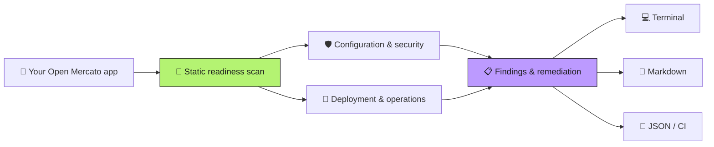

<p align="center"></p>

<h1 align="center">Open Mercato Readiness Scanner</h1>

<p align="center"><strong>Find production-readiness gaps before you deploy.</strong></p>

<p align="center">Read-only readiness scans for applications built with create-mercato-app.<br />Check local configuration, get actionable findings, and export reports for your release process.</p>

<p align="center">
  <a href="https://www.npmjs.com/package/mercato-readiness-scanner"></a>
  <a href="https://nodejs.org/"></a>
  <a href="https://github.com/open-mercato/mercato-readiness-scanner/actions/workflows/test.yml"></a>
  
</p>

```bash
npx mercato-readiness-scanner scan .
```

<p align="center"><a href="#quick-start">Quick start</a> · <a href="#save-a-report">Reports</a> · <a href="#use-in-ci">CI</a> · <a href="#rule-catalog">Rules</a> · <a href="https://docs.openmercato.com/">Framework docs</a> · <a href="https://discord.gg/f4qwPtJ3qA">Discord</a></p>



`scan` is read-only. The explicit [`apply`](#apply-the-remediations) command can add safe fixes to a git working tree.

## Quick start

You need **Node.js 24 or newer** and an application created with
[`create-mercato-app`](https://www.npmjs.com/package/create-mercato-app).
Run from your application directory:

```bash
cd my-open-mercato-app
npx mercato-readiness-scanner scan .
```

Or pass the application path from another directory:

```bash
npx mercato-readiness-scanner scan /path/to/open-mercato-app
```

No global install is required. To see all options:

```bash
npx mercato-readiness-scanner --help
```

The default terminal report groups failed, review-only, skipped, and passing
checks with `❌`, `⚠️`, `⏭️`, and `✅` markers. Every actionable result includes
remediation text and a permanent rule-documentation URL.

## Check credentials and encryption keys

Credential inspection runs automatically in every scan:

```bash
npx mercato-readiness-scanner@0.2.2 scan . --fail-on high
```

`scan` inspects root `.env`, `.env.production`, `.env.local`, and
`.env.production.local` files, visible runtime settings, and supported Compose
service environments. It checks every detected credential-like setting, including
JWT/signing secrets, database and Redis passwords, other service passwords,
API tokens/keys, and tenant encryption fallback/master keys. Database URL
passwords, copied template credentials, and `${NAME:-default}` fallbacks are
included. File contents remain in memory; findings contain variable names and
fixed reasons, never credential values. Application code and shell expressions
are never executed. `apply` does not read or change these values.

| Finding | Behavior |
|---|---|
| ❌ Default, placeholder, or copied template credential | Critical failure |
| ❌ Short, repeated, or predictable credential | Critical failure |
| ❌ Weak tenant encryption fallback/master key | Critical failure |
| ❌ Development fallback enabled without an explicit tenant key | Critical failure |
| ⚠️ No complete KMS configuration | Configure Vault; inject durable keys through a secret mechanism |
| ⚠️ Local production `.env` paths | Verify secrets are excluded from deployed artifacts |
| ⚠️ Missing, unresolved, or uninspectable credentials | Verify deployment-injected settings separately |

Signing and encryption keys require at least **32 bytes** of key material;
passwords require at least **16 characters**. Recognized hex/base64 keys are
checked after decoding. These heuristics cannot prove randomness or credential
validity. Private-key files, secret stores, external Compose `env_file` paths,
and application code are not inspected. See the
[credential rule](docs/rules/secrets-credential-strength.md) for coverage and limits.

**Without KMS, inject encryption keys using Railway or Cloudflare secrets, a
secret manager, or GitHub Actions secrets during deployment. Do not deploy keys
in a plaintext `.env` file.** Keep durable recovery copies and plan key rotation:
replacing an existing encryption key can make stored data unreadable. A hosting
secret mechanism delivers values; KMS also manages encryption-key operations.

Since **0.2.1**, credential-strength and encryption-key checks run by default.
The old `--check-secrets` flag remains accepted for compatibility. KMS and
secret-delivery review warnings appear in every scan. Even with Vault settings
present, live KMS access and recovery need verification.

## Save a report

Keep the formatted terminal report on screen while writing both portable
formats:

```bash
npx mercato-readiness-scanner scan . --markdown readiness.md --json readiness.json
```

Or select a single standard-output format and optionally save it:

```bash
npx mercato-readiness-scanner scan . --format markdown --output readiness.md
npx mercato-readiness-scanner scan . --format json --output readiness.json
```

When `--output` names a file, the CLI writes that file atomically and leaves
stdout empty; use `--output -` for explicit stdout. The `--markdown` and `--json`
convenience flags instead add files while retaining the formatted terminal
report on stdout.

## Use in CI

Pin the scanner version and fail the job on high or critical findings while
saving a JSON report:

```bash
npx --yes mercato-readiness-scanner@0.2.2 scan . --json readiness.json --fail-on high
```

`--fail-on` accepts `critical`, `high`, `medium`, `low`, or `never` (the default).
Only failed checks count toward the threshold; review findings require operator
verification. Reports are rendered or saved before the exit threshold is applied.

| Exit code | Meaning |
|---|---|
| `0` | ✅ Scan completed; no failed check met the threshold |
| `1` | ❌ A failed check met the selected severity threshold |
| `2` | ⚠️ Invalid usage or an unsupported application target |
| `3` | 🛑 Unexpected scanner or report-writing failure |

## Apply the remediations

`mercato-readiness apply` is the one opt-in exception to the read-only rule. It has two modes.

### Test the fixes

Start in a clean Git working tree, then preview the changes:

```bash
npx mercato-readiness-scanner@0.2.2 apply . --dry-run
```

Apply the safe changes, review the tracked diff and any newly created files,
then scan again:

```bash
npx mercato-readiness-scanner@0.2.2 apply . --yes
git status --short
git diff
npx mercato-readiness-scanner@0.2.2 scan . --fail-on high
```

`apply` uses 🔧 for proposed fixes, ✅ for completed changes, and ⏭️ for skipped
items. It can add missing ignore patterns, build/start scripts, and runbook stubs.
Credential rotation, encryption keys, KMS provisioning, and existing deployment
configuration require manual changes. The final scan can therefore still report
failures after all safe fixes have been applied. Runbook stubs require operator
verification. To test idempotence after reviewing the changes, a second
`apply . --yes --allow-dirty` should report `0 change(s) written`.

### Hard preconditions

`apply` refuses to write anything unless both hold:

- The target is a git working tree (`git rev-parse --is-inside-work-tree`). Git is the only undo
  for these writes, so a non-git target exits 2 with an actionable error.
- That worktree has no uncommitted changes, so you can always tell with `git diff` and
  `git status` exactly what was written. Pass `--allow-dirty` to apply over existing changes
  anyway. Untracked files count as uncommitted, because newly created files are untracked too.

On a TTY, `apply` prints the plan and asks before writing. It never prompts when stdin is not a
TTY: there, without `--yes` (alias `--non-interactive`), it exits 2 with a usage error instead of
hanging. `--dry-run` reports the plan and writes nothing.

### Mode `direct` (default): the CLI writes the safe fixes

```bash
npx mercato-readiness-scanner apply /path/to/open-mercato-app            # asks first on a TTY
npx mercato-readiness-scanner apply /path/to/open-mercato-app --dry-run  # plan only, writes nothing
```

Only policies that are **purely additive and cannot lose data** are applied. Every rule carries an
explicit safety class, so each one is deliberately either auto-fixable or manual-only. Today these
four rules are auto-fixable:

| Rule | What `apply` writes |
|---|---|
| [`secrets-ignore-policy`](docs/rules/secrets-ignore-policy.md) | appends the missing ignore patterns to `.gitignore`, or creates it |
| [`runtime-production-scripts`](docs/rules/runtime-production-scripts.md) | inserts a missing `build` or `start` key into `package.json` |
| [`data-backup-restore-runbook`](docs/rules/data-backup-restore-runbook.md) | creates a `docs/runbooks/backup-and-restore.md` stub |
| [`release-rollback-runbook`](docs/rules/release-rollback-runbook.md) | creates a `docs/runbooks/rollback-and-forward-fix.md` stub |

What `apply` never does: overwrite or truncate existing content, rewrite existing configuration,
delete anything, write or read any `.env*` or credential file, follow a symlink, write outside the
application root, or run the target's scripts. An existing `package.json` script value is never
changed — only a missing key is inserted, and only when the file round-trips byte-for-byte through
`JSON.parse`/`JSON.stringify` so the inserted key is provably the only difference. The runbook
stubs are TODO checklists: they move a rule from ❌ to ⚠️ *review*, they do not prove a backup or
a rehearsal happened.

Every other rule stays manual-only and is reported as skipped with the reason and its docs URL.
A second `apply` against an already-fixed project is a no-op.

### Mode `agent`: delegate to `cezar-run`

Instead of writing files, `apply --mode agent` builds a remediation prompt from the scan results
and hands it to the [`cezar-run`](https://www.npmjs.com/package/cezar-run) CLI. The prompt carries
the findings, the per-rule documentation URLs, the secret-handling constraints, and a definition of
done. It references the report file when this run saved one (via `--markdown`, `--json`, or
`--output`) and inlines the Markdown report otherwise.

```bash
# Inspect the prompt without running anything.
npx mercato-readiness-scanner apply . --mode agent --print-prompt

# Resolve the binary explicitly, then delegate.
npx mercato-readiness-scanner apply . --mode agent --cezar-run ~/.local/bin/cezar-run --yes
```

The binary is resolved from `--cezar-run`, then the `MERCATO_READINESS_CEZAR_RUN` environment
variable, then a bare `cezar-run` on `PATH`; an explicit flag or env value must point at an
executable file. The invocation is `cezar-run run "<prompt>" --repo <target>`, optionally with
`--workflow <name>`. No model and no provider is ever passed — that stays `cezar-run`'s decision,
and no other agent CLI is ever spawned. Agent execution has a 15-minute timeout. The prompt forbids running application scripts; validate those separately as an operator.

### Non-interactive CI invocation

Copy-pasteable, and safe to run on a clean checkout:

```bash
npx mercato-readiness-scanner apply . --yes --no-color
# Review the diff and run your own validation before committing.
npx mercato-readiness-scanner scan . --fail-on high
```

`apply` exits 0 when it finishes (including when there was nothing to do), 2 on a refused
precondition — not a git working tree, uncommitted changes without `--allow-dirty`, a missing
`--yes` on a non-TTY, an unusable `cezar-run` path, or an unsafe write target — and 3 on an
unexpected failure. In agent mode it returns `cezar-run`'s own exit code.

## What the scanner does

The scanner recognizes a generated Open Mercato app by its
`@open-mercato/core` dependency and `src/modules.ts`. It examines only bounded,
local configuration and documentation surfaces. It never runs target scripts,
loads the application, contacts its services, or performs network probes — in
`scan` and in `apply` alike.

The Open Mercato framework monorepo is rejected with exit code 2, including when
scanning from its internal app, a package, or another subdirectory. A monorepo is
not a valid way to start a production app: create a standalone application with
`create-mercato-app` and scan that application instead. The
[`runtime-standalone-application`](docs/rules/runtime-standalone-application.md)
target guard runs before readiness checks or report output, regardless of
`--fail-on` or report format. Generated applications in unrelated workspaces
remain supported.

Scans inspect supported production `.env` files and runtime credentials in
memory by default, as described above. `apply` does not read live credentials. Git is queried
only for tracked path names to identify committed environment files. Repository hooks, filesystem monitors, and optional Git locks are
disabled for that read-only query. Only the explicitly sanitized `.env.example`, `.env.sample`, and
`.env.template` forms are eligible for the default template configuration checks. Evidence omits
absolute paths and configuration values.

Static evidence cannot prove live TLS, backups, restores, alerts, or provider
settings. Those checks intentionally return `⚠️ review` when configuration or a
runbook exists but an operator still needs to verify the deployed environment.

## Rule catalog

Each best practice has a stable ID and its own documentation URL. Rule IDs are
also stable machine keys in the JSON report.

| Severity | Best practice |
|---|---|
| 🔴 Critical | [Credentials reject weak values and published defaults](docs/rules/secrets-credential-strength.md) |
| 🔴 Critical | [Encryption keys reject weak fallbacks and development defaults](docs/rules/secrets-encryption-key-strength.md) |
| 🟠 High | [KMS configuration and key custody are verified](docs/rules/secrets-kms-configuration.md) |
| 🟠 High | [Production secrets are injected through a secret mechanism](docs/rules/secrets-deployment-injection.md) |
| 🔴 Critical | [Live environment files are not tracked](docs/rules/secrets-live-env-untracked.md) |
| 🔴 Critical | [Credential and private-key files are not tracked](docs/rules/secrets-no-tracked-credentials.md) |
| 🟠 High | [Sensitive local files are ignored](docs/rules/secrets-ignore-policy.md) |
| 🟠 High | [Production configuration has a sanitized template](docs/rules/runtime-env-template.md) |
| 🟠 High | [Production build and start scripts are explicit](docs/rules/runtime-production-scripts.md) |
| 🔴 Critical | [TLS and canonical origin are verified at deployment](docs/rules/edge-tls-and-canonical-origin.md) |
| 🟠 High | [Trusted proxy depth is topology-specific](docs/rules/edge-trusted-proxy-depth.md) |
| 🟠 High | [Browser and real-time origins are restricted](docs/rules/edge-allowed-origins.md) |
| 🟠 High | [Application security headers are configured](docs/rules/edge-security-headers.md) |
| 🟠 High | [A deployment health check is wired](docs/rules/operations-health-check.md) |
| 🔴 Critical | [Stateful services are not publicly published](docs/rules/infrastructure-private-services.md) |
| 🟠 High | [Production containers run as non-root](docs/rules/container-non-root-user.md) |
| 🟠 High | [Deployments use immutable dependency installation](docs/rules/supply-chain-immutable-install.md) |
| 🟡 Medium | [Exactly one package lockfile is committed](docs/rules/supply-chain-single-lockfile.md) |
| 🟠 High | [Multi-process deployments use shared Redis coordination](docs/rules/infrastructure-shared-redis.md) |
| 🟠 High | [Database migrations are part of release startup](docs/rules/release-database-migrations.md) |
| 🟠 High | [Production deploys select an immutable artifact](docs/rules/release-immutable-artifact.md) |
| 🟠 High | [Release validation gates the exact revision](docs/rules/release-validation-gate.md) |
| 🟠 High | [Background workers have an explicit process topology](docs/rules/operations-worker-topology.md) |
| 🟠 High | [Web and worker processes use the same release artifact](docs/rules/workers-release-parity.md) |
| 🟠 High | [Local storage is placed on persistent media](docs/rules/storage-persistent-volume.md) |
| 🔴 Critical | [Backups and restore rehearsal are documented](docs/rules/data-backup-restore-runbook.md) |
| 🟠 High | [Rollback and forward-fix procedures are documented](docs/rules/release-rollback-runbook.md) |
| 🟡 Medium | [Logs and telemetry have a production pipeline](docs/rules/observability-telemetry-pipeline.md) |
| 🟡 Medium | [The app pins a supported Node.js runtime](docs/rules/runtime-supported-node.md) |
| 🟠 High | [Development-only features default off](docs/rules/runtime-debug-features-disabled.md) |

The overall operational baseline is the Open Mercato
[Production Readiness checklist](https://docs.openmercato.com/deployment/production-readiness).

## JSON contract

JSON output follows [`docs/report.schema.json`](docs/report.schema.json). It
contains the scanner version, scan timestamp, target directory name, aggregate
counts, and one result per rule. Consumers should key on `schemaVersion` and
`results[].id`, not display text. Version 0.2.0 adds four rule results; the
JSON shape and `schemaVersion: 1` are unchanged. Schema version 1 retains the original
`tool.name` value, `@open-mercato/mercato-readiness-scanner`, for compatibility;
the npm package and primary CLI command are `mercato-readiness-scanner`.

`schemaVersion` stays `1`: the apply-mode safety classification is CLI metadata and is
deliberately kept out of the report, so the report shape is unchanged by the `apply` command.

## Development

```bash
git clone https://github.com/open-mercato/mercato-readiness-scanner.git
cd mercato-readiness-scanner
npm ci
npm run check
node dist/cli.js --help
```

`npm run check` type-checks, runs the source and built-CLI test suites, builds the
CLI, verifies the npm package contents, and checks the npm registry identity.
The original `mercato-readiness` executable remains available as an alias.

For maintainers, `npm publish` runs the full checks through `prepublishOnly`.
Publishing a release requires explicit approval and npm authentication.

---

Part of [Open Mercato](https://github.com/open-mercato/open-mercato).
[Website](https://openmercato.com/) · [Framework docs](https://docs.openmercato.com/) · [Discord](https://discord.gg/f4qwPtJ3qA)
