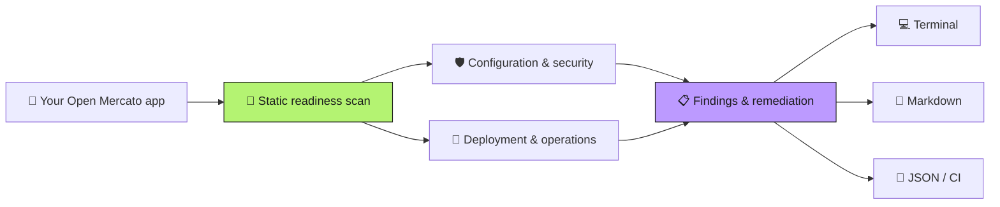

<p align="center"></p>

<h1 align="center">Open Mercato Readiness Scanner</h1>

<p align="center"><strong>Find production-readiness gaps before you deploy.</strong></p>

<p align="center">A read-only CLI for applications built with create-mercato-app.<br />Check local configuration, get actionable findings, and export reports for your release process.</p>

<p align="center">
  <a href="https://www.npmjs.com/package/mercato-readiness-scanner"></a>
  <a href="https://nodejs.org/"></a>
  <a href="https://github.com/open-mercato/mercato-readiness-scanner/actions/workflows/test.yml"></a>
  
</p>

```bash
npx mercato-readiness-scanner scan .
```

<p align="center"><a href="#quick-start">Quick start</a> · <a href="#save-a-report">Reports</a> · <a href="#use-in-ci">CI</a> · <a href="#rule-catalog">Rules</a> · <a href="https://docs.openmercato.com/">Framework docs</a> · <a href="https://discord.gg/f4qwPtJ3qA">Discord</a></p>



## Quick start

You need **Node.js 24 or newer** and an application created with
[`create-mercato-app`](https://www.npmjs.com/package/create-mercato-app).
Run from your application directory:

```bash
cd my-open-mercato-app
npx mercato-readiness-scanner scan .
```

Or pass the application path from another directory:

```bash
npx mercato-readiness-scanner scan /path/to/open-mercato-app
```

No global install is required. To see all options:

```bash
npx mercato-readiness-scanner --help
```

The default terminal report groups failed, review-only, skipped, and passing
checks with `❌`, `⚠️`, `⏭️`, and `✅` markers. Every actionable result includes
remediation text and a permanent rule-documentation URL.

## Save a report

Keep the formatted terminal report on screen while writing both portable
formats:

```bash
npx mercato-readiness-scanner scan . --markdown readiness.md --json readiness.json
```

Or select a single standard-output format and optionally save it:

```bash
npx mercato-readiness-scanner scan . --format markdown --output readiness.md
npx mercato-readiness-scanner scan . --format json --output readiness.json
```

When `--output` names a file, the CLI writes that file atomically and leaves
stdout empty; use `--output -` for explicit stdout. The `--markdown` and `--json`
convenience flags instead add files while retaining the formatted terminal
report on stdout.

## Use in CI

Pin the scanner version and fail the job on high or critical findings while
saving a JSON report:

```bash
npx --yes mercato-readiness-scanner@0.1.0 scan . --json readiness.json --fail-on high
```

`--fail-on` accepts `critical`, `high`, `medium`, `low`, or `never` (the default).
Only failed checks count toward the threshold; review findings require operator
verification. Reports are rendered or saved before the exit threshold is applied.

| Exit code | Meaning |
|---|---|
| `0` | ✅ Scan completed; no failed check met the threshold |
| `1` | ❌ A failed check met the selected severity threshold |
| `2` | ⚠️ Invalid usage or an unsupported application target |
| `3` | 🛑 Unexpected scanner or report-writing failure |

## What the scanner does

The scanner recognizes a generated Open Mercato app by its
`@open-mercato/core` dependency and `src/modules.ts`. It examines only bounded,
local configuration and documentation surfaces. It never runs target scripts,
loads the application, contacts its services, or performs network probes.

The Open Mercato framework monorepo is rejected with exit code 2, including when
scanning from its internal app, a package, or another subdirectory. A monorepo is
not a valid way to start a production app: create a standalone application with
`create-mercato-app` and scan that application instead. The
[`runtime-standalone-application`](docs/rules/runtime-standalone-application.md)
target guard runs before readiness checks or report output, regardless of
`--fail-on` or report format. Generated applications in unrelated workspaces
remain supported.

Live `.env*` files are never opened. Git is queried only for tracked path names
so the scanner can report a committed live environment file without reading its
contents. Repository hooks, filesystem monitors, and optional Git locks are
disabled for that read-only query. Only the explicitly sanitized `.env.example`, `.env.sample`, and
`.env.template` forms are eligible for configuration-name checks. Evidence omits
absolute paths and configuration values.

Static evidence cannot prove live TLS, backups, restores, alerts, or provider
settings. Those checks intentionally return `⚠️ review` when configuration or a
runbook exists but an operator still needs to verify the deployed environment.

## Rule catalog

Each best practice has a stable ID and its own documentation URL. Rule IDs are
also stable machine keys in the JSON report.

| Severity | Best practice |
|---|---|
| 🔴 Critical | [Live environment files are not tracked](docs/rules/secrets-live-env-untracked.md) |
| 🔴 Critical | [Credential and private-key files are not tracked](docs/rules/secrets-no-tracked-credentials.md) |
| 🟠 High | [Sensitive local files are ignored](docs/rules/secrets-ignore-policy.md) |
| 🟠 High | [Production configuration has a sanitized template](docs/rules/runtime-env-template.md) |
| 🟠 High | [Production build and start scripts are explicit](docs/rules/runtime-production-scripts.md) |
| 🔴 Critical | [TLS and canonical origin are verified at deployment](docs/rules/edge-tls-and-canonical-origin.md) |
| 🟠 High | [Trusted proxy depth is topology-specific](docs/rules/edge-trusted-proxy-depth.md) |
| 🟠 High | [Browser and real-time origins are restricted](docs/rules/edge-allowed-origins.md) |
| 🟠 High | [Application security headers are configured](docs/rules/edge-security-headers.md) |
| 🟠 High | [A deployment health check is wired](docs/rules/operations-health-check.md) |
| 🔴 Critical | [Stateful services are not publicly published](docs/rules/infrastructure-private-services.md) |
| 🟠 High | [Production containers run as non-root](docs/rules/container-non-root-user.md) |
| 🟠 High | [Deployments use immutable dependency installation](docs/rules/supply-chain-immutable-install.md) |
| 🟡 Medium | [Exactly one package lockfile is committed](docs/rules/supply-chain-single-lockfile.md) |
| 🟠 High | [Multi-process deployments use shared Redis coordination](docs/rules/infrastructure-shared-redis.md) |
| 🟠 High | [Database migrations are part of release startup](docs/rules/release-database-migrations.md) |
| 🟠 High | [Production deploys select an immutable artifact](docs/rules/release-immutable-artifact.md) |
| 🟠 High | [Release validation gates the exact revision](docs/rules/release-validation-gate.md) |
| 🟠 High | [Background workers have an explicit process topology](docs/rules/operations-worker-topology.md) |
| 🟠 High | [Web and worker processes use the same release artifact](docs/rules/workers-release-parity.md) |
| 🟠 High | [Local storage is placed on persistent media](docs/rules/storage-persistent-volume.md) |
| 🔴 Critical | [Backups and restore rehearsal are documented](docs/rules/data-backup-restore-runbook.md) |
| 🟠 High | [Rollback and forward-fix procedures are documented](docs/rules/release-rollback-runbook.md) |
| 🟡 Medium | [Logs and telemetry have a production pipeline](docs/rules/observability-telemetry-pipeline.md) |
| 🟡 Medium | [The app pins a supported Node.js runtime](docs/rules/runtime-supported-node.md) |
| 🟠 High | [Development-only features default off](docs/rules/runtime-debug-features-disabled.md) |

The overall operational baseline is the Open Mercato
[Production Readiness checklist](https://docs.openmercato.com/deployment/production-readiness).

## JSON contract

JSON output follows [`docs/report.schema.json`](docs/report.schema.json). It
contains the scanner version, scan timestamp, target directory name, aggregate
counts, and one result per rule. Consumers should key on `schemaVersion` and
`results[].id`, not display text. Schema version 1 retains the original
`tool.name` value, `@open-mercato/mercato-readiness-scanner`, for compatibility;
the npm package and primary CLI command are `mercato-readiness-scanner`.

## Development

```bash
git clone https://github.com/open-mercato/mercato-readiness-scanner.git
cd mercato-readiness-scanner
npm ci
npm run check
node dist/cli.js --help
```

`npm run check` type-checks, runs the source and built-CLI test suites, builds the
CLI, verifies the npm package contents, and checks the npm registry identity.
The original `mercato-readiness` executable remains available as an alias.

For maintainers, `npm publish` runs the full checks through `prepublishOnly`.
Publishing a release requires explicit approval and npm authentication.

---

Part of [Open Mercato](https://github.com/open-mercato/open-mercato).
[Website](https://openmercato.com/) · [Framework docs](https://docs.openmercato.com/) · [Discord](https://discord.gg/f4qwPtJ3qA)
